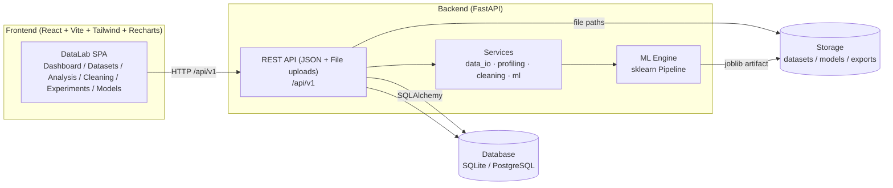
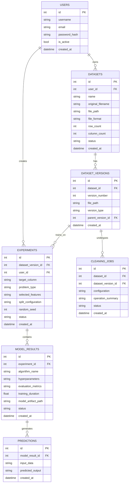

# DataLab

**DataLab** is an automated data analysis, data cleaning, and machine learning platform. It lets a user upload tabular datasets, profile and clean them, run exploratory analysis, train and compare machine learning models, persist the best models, and serve predictions — all from a single web application.

[](https://react.dev/)
[](https://vitejs.dev/)
[](https://tailwindcss.com/)
[](https://fastapi.tiangolo.com/)
[](https://www.python.org/)
[](https://scikit-learn.org/)

- **Repository:** [https://github.com/jakeer939/DataLab](https://github.com/jakeer939/DataLab)
- **Backend API:** FastAPI (`/api/v1`, health at `/health`)
- **Frontend:** React 18 + Vite 5 + Tailwind CSS 3 + Recharts
- **Database:** SQLAlchemy ORM with SQLite (default) or PostgreSQL
- **ML:** Pandas / NumPy / Scikit-learn / XGBoost
- **Status:** Implemented and verified end-to-end — final audit status: **READY WITH LIMITATIONS** ([AUDIT_REPORT.md](./AUDIT_REPORT.md))

---

## Table of Contents

1. [Project Header](#a-project-header)
2. [Project Overview](#b-project-overview)
3. [Key Features](#c-key-features)
4. [Application Workflow](#d-application-workflow)
5. [Technology Stack](#e-technology-stack)
6. [System Architecture](#f-system-architecture)
7. [Project Folder Structure](#g-project-folder-structure)
8. [Installation and Setup](#h-installation-and-setup)
9. [Environment Variables](#i-environment-variables)
10. [API Documentation](#j-api-documentation)
11. [Machine Learning Methodology](#k-machine-learning-methodology)
12. [Database Design](#l-database-design)
13. [Screenshots](#m-screenshots)
14. [Testing](#n-testing)
15. [Future Enhancements](#o-future-enhancements)
16. [Contributing](#p-contributing)
17. [License](#q-license)

---

## A. Project Header

| Item | Detail |
|---|---|
| Project name | DataLab |
| Short description | Automated data analysis, data cleaning, and machine learning platform |
| Primary purpose | Turn raw tabular data into cleaned datasets, actionable insights, trained models, and predictions through one workflow |
| Main technologies | React 18, Vite 5, Tailwind CSS 3, Recharts (frontend); Python 3.13, FastAPI, SQLAlchemy, Pydantic, JWT auth (backend); Pandas, NumPy, Scikit-learn, XGBoost (ML) |
| Database | SQLite (default) / PostgreSQL, via SQLAlchemy ORM |
| Project status | Implemented and verified end-to-end; final audit status **READY WITH LIMITATIONS** |
| Repository | [https://github.com/jakeer939/DataLab](https://github.com/jakeer939/DataLab) |

## B. Project Overview

DataLab addresses a common pain point in data science teams: the same exploratory and machine learning steps are repeated manually for every new dataset — profiling, quality checks, cleaning, visualizations, training, comparison, and prediction.

The platform is built around a single user journey:

1. **Upload** a CSV / Excel dataset.
2. **Profile** the dataset (statistics, missing values, duplicates, outliers, correlations, charts).
3. **Clean** the dataset (configurable operations with an audit trail and versioning).
4. **Analyze** visually via the profiling/EDA views.
5. **Configure and train** ML experiments.
6. **Compare** model results on a leaderboard.
7. **Save** the best model artifact.
8. **Predict** with saved models (single and batch).

All of these steps are implemented in the current codebase and were exercised end-to-end during the audit (see [`AUDIT_REPORT.md`](./AUDIT_REPORT.md)).

## C. Key Features

### Implemented

- **Authentication & multi-user isolation:** register, login, logout, current-user endpoint; JWT bearer tokens; all dataset/experiment/model resources are scoped to the owning user (foreign resources return `404`).
- **Dataset management:** CSV / XLSX / XLS upload (with extension and size validation, duplicate-header detection, encoding fallback), paginated data preview, version history, dataset download, and cascading delete.
- **Profiling & EDA:** overview statistics, per-column profiling (numeric / categorical / datetime), missing-value and duplicate analysis, outlier detection, correlation computation, and chart data generation.
- **Data cleaning:** configurable operations — missing-value handling (drop rows / impute), deduplication, outlier handling (detect / remove / cap), feature encoding (label / one-hot), feature scaling (min-max / z-score), and data-type conversion — with operation summaries and history.
- **ML experiments:** algorithm catalog, train/test splitting, preprocessing inside a single fitted `sklearn` pipeline, classification (logistic regression, decision tree, optional XGBoost) and regression (linear regression, ridge, optional XGBoost) workflows, evaluation metrics, and ranked results.
- **Model persistence & prediction:** fitted pipelines serialized with the feature schema; single and batch prediction endpoints; prediction history.
- **Frontend dashboard:** overview stats, dataset listing, charts, and navigation.

### Partially implemented

- Frontend responsive behavior was verified via browser-based viewport emulation; real-device testing was not possible in the audit environment.
- The database schema retains legacy denormalized JSON columns for API compatibility alongside the relational foreign keys.
- Frontend has no automated unit test suite (backend-only pytest suite).

### Planned

- Real-device / native mobile browser testing.
- PostgreSQL runtime verification.
- Additional algorithms (e.g., additional tree-based or boosting models).
- Report export / sharing features.
- Scheduled or background training jobs.

## D. Application Workflow

The implemented end-to-end workflow:

```
Dataset Upload → Dataset Profiling → Data Cleaning → EDA → ML Configuration → Model Training → Model Comparison → Model Saving → Prediction
```

| Step | Status | Notes |
|---|---|---|
| Dataset upload | ✅ Implemented & tested | `POST /api/v1/datasets/upload` |
| Dataset profiling / EDA | ✅ Implemented & tested | Profiling, quality, correlation, scatter endpoints + charts |
| Data cleaning | ✅ Implemented & tested | Configurable ops, versioned, history recorded |
| ML configuration | ✅ Implemented & tested | Target column, problem type, features, split config, seed |
| Model training | ✅ Implemented & tested | sklearn pipelines per algorithm |
| Model comparison | ✅ Implemented & tested | Leaderboard with ranking/filtering |
| Model saving | ✅ Implemented & tested | Persisted artifacts + feature schema |
| Prediction | ✅ Implemented & tested | Single + batch, persisted |

## E. Technology Stack

### Backend

| Concern | Technology |
|---|---|
| Framework | FastAPI 0.136 |
| ASGI server | Uvicorn (standard) |
| ORM | SQLAlchemy 2.1 |
| Database | SQLite (default) / PostgreSQL |
| Validation | Pydantic v2 (`pydantic[email]`) |
| Auth | python-jose (JWT, HS256), passlib/argon2 |
| File uploads | python-multipart, `UploadFile` |
| Config | python-dotenv, env-driven |
| ML | Pandas, NumPy, Scikit-learn, XGBoost, joblib, SciPy |
| Data formats | CSV, Excel (openpyxl / xlrd / xlsxwriter) |

### Frontend

| Concern | Technology |
|---|---|
| UI library | React 18.3 |
| Build tool | Vite 5.4 |
| Styling | Tailwind CSS 3.4 |
| HTTP client | Axios |
| Routing | react-router-dom 6 |
| Charts | Recharts 2.15 |
| Icons | lucide-react |

## F. System Architecture

The application follows a conventional client–server architecture:

```
React SPA (Vite + Tailwind + Recharts)
        │  HTTP /api/v1 (JSON + file uploads, via Vite dev/preview proxy)
        ▼
FastAPI REST API
   ├── Routers: auth, datasets, profiling, cleaning, experiments, models
   ├── Services: data_io, profiling, cleaning, ml
   └── ML engine: sklearn Pipeline (fit on training data only)
        │  SQLAlchemy ORM
        ▼
SQLite / PostgreSQL   +   Storage directory (datasets / models / exports)
```



## G. Project Folder Structure

```
DataLab/
├── AUDIT_REPORT.md
├── README.md
├── .env.example
├── .gitignore
├── backend/
│   ├── app/
│   │   ├── __init__.py
│   │   ├── main.py                  # FastAPI app, lifespan, CORS, routers
│   │   ├── config.py                # env config, storage paths, limits
│   │   ├── database.py              # SQLAlchemy engine/session, init_db
│   │   ├── models.py                # ORM models (users, datasets, versions, jobs, experiments, models, predictions)
│   │   ├── schemas.py               # Pydantic schemas
│   │   ├── security.py              # JWT / password hashing / auth dependencies
│   │   ├── dependencies.py
│   │   ├── routers/
│   │   │   ├── __init__.py
│   │   │   ├── auth.py
│   │   │   ├── cleaning.py
│   │   │   ├── datasets.py
│   │   │   ├── experiments.py
│   │   │   ├── models.py
│   │   │   └── profiling.py
│   │   └── services/
│   │       ├── __init__.py
│   │       ├── cleaning_service.py
│   │       ├── data_io.py
│   │       ├── ml_service.py
│   │       └── profiling_service.py
│   ├── tests/
│   │   ├── __init__.py
│   │   ├── conftest.py
│   │   ├── test_auth.py
│   │   ├── test_cleaning.py
│   │   ├── test_datasets.py
│   │   ├── test_ml.py
│   │   ├── test_models.py
│   │   ├── test_profiling.py
│   │   └── test_services.py
│   ├── requirements.txt
│   └── storage/                     # runtime data (git-ignored)
├── frontend/
│   ├── public/
│   │   └── favicon.svg
│   ├── src/
│   │   ├── api/
│   │   │   └── client.js
│   │   ├── components/
│   │   │   ├── analysis/  (feature components)
│   │   │   ├── cleaning/
│   │   │   ├── common/
│   │   │   ├── datasets/
│   │   │   ├── experiments/
│   │   │   └── models/
│   │   ├── context/
│   │   │   └── AuthContext.jsx
│   │   ├── layouts/
│   │   ├── pages/
│   │   │   ├── Analysis.jsx
│   │   │   ├── Cleaning.jsx
│   │   │   ├── Dashboard.jsx
│   │   │   ├── DatasetDetails.jsx
│   │   │   ├── DatasetUpload.jsx
│   │   │   ├── Datasets.jsx
│   │   │   ├── Experiments.jsx
│   │   │   ├── Login.jsx
│   │   │   ├── ModelDetails.jsx
│   │   │   ├── ModelLeaderboard.jsx
│   │   │   ├── NotFound.jsx
│   │   │   ├── Register.jsx
│   │   ├── services/
│   │   ├── utils/
│   │   ├── App.jsx
│   │   ├── index.css
│   │   └── main.jsx
│   ├── .eslintrc.cjs
│   ├── index.html
│   ├── package.json
│   ├── package-lock.json
│   ├── postcss.config.js
│   ├── tailwind.config.js
│   ├── vite.config.ts
│   └── vite-env.d.ts
├── .env.example
├── .gitignore
└── ...
```

> Note: empty feature-component folders under `frontend/src/components/` are placeholders; page-level components live under `src/pages/`.

## H. Installation and Setup

### Prerequisites

- Python 3.13+
- Node.js 18+ / npm
- (Optional) PostgreSQL 18 for production-like database usage

### Backend

```bash
cd backend
python -m venv .venv
.venv\Scripts\activate      # Windows
# source .venv/bin/activate   # Linux / macOS

pip install -r requirements.txt
```

The FastAPI application initializes the database schema automatically on startup (`Base.metadata.create_all`).

```bash
uvicorn app.main:app --host 127.0.0.1 --port 8000
```

Interactive API docs: <http://127.0.0.1:8000/docs>

### Frontend

```bash
cd frontend
npm install
npm run dev
```

The Vite dev server runs on <http://127.0.0.1:5173> and proxies `/api` to `http://127.0.0.1:8000`.

For production build preview:

```bash
npm run build
npm run preview
```

## I. Environment Variables

Copy `.env.example` to `backend/.env` and adjust.

| Variable | Purpose | Default |
|---|---|---|
| `APP_NAME` | Application name | `DataLab` |
| `DEBUG` | Debug mode | `false` |
| `SECRET_KEY` | JWT signing secret | dev placeholder |
| `ALGORITHM` | JWT algorithm | `HS256` |
| `ACCESS_TOKEN_EXPIRE_MINUTES` | Token lifetime | `1440` |
| `DATABASE_URL` | SQLAlchemy DB URL | `sqlite:///./backend/datalab.db` |
| `STORAGE_DIR` | Runtime storage root | `./backend/storage` |
| `MAX_UPLOAD_BYTES` | Max upload size (bytes) | `104857600` (100 MB) |
| `CORS_ORIGINS` | Allowed frontend origins | localhost:5173 / 4173 |

Never commit real secrets.

## J. API Documentation

All business endpoints are prefixed with `/api/v1`. Health: `GET /health`.

### Authentication

| Method | Endpoint | Purpose | Auth |
|---|---|---|---|
| POST | `/api/v1/auth/register` | Register user | Public |
| POST | `/api/v1/auth/login` | Login, returns token | Public |
| GET | `/api/v1/auth/me` | Current user | Bearer |
| POST | `/api/v1/auth/logout` | Logout | Bearer |

### Datasets

| Method | Endpoint | Purpose | Auth |
|---|---|---|---|
| POST | `/api/v1/datasets/upload` | Upload CSV/XLSX/XLS | Bearer |
| GET | `/api/v1/datasets/` | List owned datasets | Bearer |
| GET | `/api/v1/datasets/{dataset_id}` | Get dataset info | Bearer |
| GET | `/api/v1/datasets/{dataset_id}/preview` | Preview rows (offset/limit/version) | Bearer |
| GET | `/api/v1/datasets/{dataset_id}/versions` | List versions | Bearer |
| GET | `/api/v1/datasets/{dataset_id}/download` | Download version | Bearer |
| DELETE | `/api/v1/datasets/{dataset_id}` | Delete dataset + cascade | Bearer |

### Profiling / EDA

| Method | Endpoint | Purpose | Auth |
|---|---|---|---|
| GET | `/api/v1/profiling/{dataset_id}` | Full profile | Bearer |
| GET | `/api/v1/profiling/{dataset_id}/quality` | Quality report | Bearer |
| GET | `/api/v1/profiling/{dataset_id}/correlation` | Correlation matrix | Bearer |
| GET | `/api/v1/profiling/{dataset_id}/scatter` | Chart data | Bearer |

### Cleaning

| Method | Endpoint | Purpose | Auth |
|---|---|---|---|
| POST | `/api/v1/cleaning/{dataset_id}/start` | Run cleaning job | Bearer |
| GET | `/api/v1/cleaning/{dataset_id}/cleaning-history` | Cleaning history | Bearer |
| GET | `/api/v1/cleaning/{dataset_id}/download` | Download cleaned data | Bearer |

### Experiments & Models

| Method | Endpoint | Purpose | Auth |
|---|---|---|---|
| GET | `/api/v1/experiments/algorithms` | Algorithm catalog | Bearer |
| POST | `/api/v1/experiments/` | Create experiment | Bearer |
| GET | `/api/v1/experiments/` | List experiments | Bearer |
| GET | `/api/v1/experiments/results` | Aggregate results | Bearer |
| GET | `/api/v1/experiments/{experiment_id}` | Get experiment | Bearer |
| GET | `/api/v1/experiments/{experiment_id}/results` | Experiment results | Bearer |
| DELETE | `/api/v1/experiments/{experiment_id}` | Delete experiment | Bearer |
| GET | `/api/v1/models/` | List saved models | Bearer |
| GET | `/api/v1/models/{model_id}` | Model detail | Bearer |
| GET | `/api/v1/models/{model_id}/download` | Download artifact | Bearer |
| DELETE | `/api/v1/models/{model_id}` | Delete model | Bearer |
| POST | `/api/v1/models/{model_id}/predict` | Single prediction | Bearer |
| POST | `/api/v1/models/{model_id}/predict/batch` | Batch predictions | Bearer |
| GET | `/api/v1/models/{model_id}/predictions` | Prediction history | Bearer |

## K. Machine Learning Methodology

- **Preprocessing:** all transformations (imputation, encoding, scaling) are fitted inside a single `sklearn.pipeline.Pipeline` on the training split only.
- **Splitting:** deterministic train/test split configured per experiment (seed configurable).
- **Feature handling:** selected feature list; derived feature metadata from profiling.
- **Algorithms:**
  - Classification: Logistic Regression, Decision Tree, optional XGBoost.
  - Regression: Linear Regression, Ridge, optional XGBoost.
- **Evaluation:** metrics computed on the held-out split; results ranked on the leaderboard.
- **Persistence:** fitted pipeline + feature schema stored as a joblib artifact under the storage models directory.
- **Prediction:** single/batch inference through the persisted pipeline; predictions logged.

## L. Database Design

Core tables (SQLAlchemy ORM):

- `users` — id, username, email, password_hash, is_active, created_at (+ legacy JSON columns).
- `datasets` — id, user_id, name, original_filename, file_path, file_format, row_count, column_count, status, created_at.
- `dataset_versions` — id, dataset_id, version_number, file_path, version_type, parent_version_id, created_at (unique dataset/version).
- `cleaning_jobs` — id, dataset_id, dataset_version_id, configuration, operation_summary, status, created_at.
- `experiments` — id, dataset_version_id, user_id, target_column, problem_type, selected_features, split_configuration, random_seed, status, created_at.
- `model_results` — id, experiment_id, algorithm_name, hyperparameters, evaluation_metrics, training_duration, model_artifact_path, status, created_at.
- `predictions` — id, model_result_id, input_data, predicted_output, created_at.



## M. Screenshots

No screenshots are included in this repository. Visual verification during the audit relied on DOM, computed-style, and chart-SVG checks in a real browser; screenshot capture tooling was unavailable in the audit environment.

## N. Testing

- **Backend:** pytest suite (`backend/tests/`), isolated SQLite DB and storage per run.
- **Commands:**
  ```bash
  cd backend
  python -m pytest -q
  python -m pytest --cov=app --cov-report=term-missing -q
  ```
- **Result:** 124 passed, 1 third-party warning (`passlib`/`argon2` deprecation), coverage 92% overall.
- **Frontend:** `npm run build` (success), `npm run lint` (pass), live browser E2E (see `AUDIT_REPORT.md`).
- **Known limitations:** PostgreSQL runtime verification, real-device mobile testing, frontend unit tests.

## O. Future Enhancements

- Real-device mobile browser testing.
- PostgreSQL runtime verification.
- Additional ML algorithms.
- Report export / collaboration features.

## P. Contributing

```bash
git clone https://github.com/jakeer939/DataLab.git
cd DataLab
# backend setup: venv, pip install -r backend/requirements.txt, uvicorn app.main:app
# frontend setup: npm install, npm run dev
```

Fork → branch → commit → pull request.

## Q. License

No license has been added yet. All rights reserved by default; see the repository owner for licensing details.
